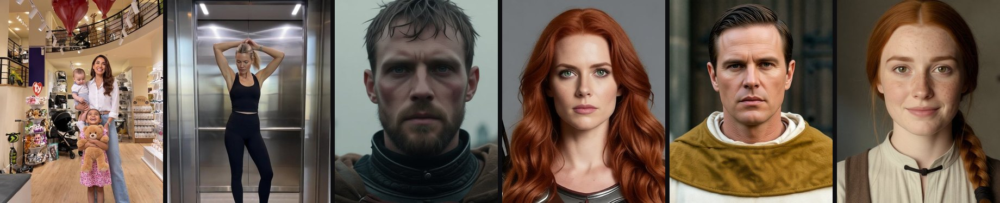

## Barış Sabuncular

**AI Video Producer · Generative AI Engineer**, based in Istanbul and open to remote or hybrid work.

I make AI video for brands and build the pipelines behind it. My focus is consistent AI casts, real products on screen, and sound that lands on the exact frame. I work in online tools such as Kling, Nano Banana Pro and ElevenLabs, and I can also run the whole pipeline locally on my own GPU.

### ▶ [Watch the portfolio: barissabuncular.github.io](https://barissabuncular.github.io)

### Client work (2026, freelance through an agency, made with online tools)

- **Minicenter: rebrand announcement.** A 36 s, 9:16 Instagram ad for a mom & baby retail chain. It uses a consistent photoreal AI cast of three wearing the client's real products. Built with Nano Banana Pro and Kling 3.0, with the edit done as code (Python + ffmpeg). The client approved it after about six revision rounds in eight days.
- **Fashion ad: the elevator.** A 12 s, 9:16 ad for a clothing brand. One consistent AI model wears three outfits, cut on the elevator doors.

### Projects

- [**ai-film-pipeline**](https://github.com/barissabuncular/ai-film-pipeline): A local AI film pipeline on one 8 GB GPU: Z-Image keyframes, character LoRAs, Wan 2.2 image-to-video, SeedVR2 upscaling and frame-accurate Foley. It powers my Diablo story series.
- [**game-asset-pipeline**](https://github.com/barissabuncular/game-asset-pipeline): A 3D-to-sprite pipeline with headless Blender rendering and in-engine validation harnesses (Godot).
- [**sprite-qc-agent**](https://github.com/barissabuncular/sprite-qc-agent): An agentic generate, measure, revise loop on the Claude API, gated by a pixel-level QC harness.
- [**vn-art-pipeline**](https://github.com/barissabuncular/vn-art-pipeline): A ComfyUI + SDXL production system: workflow-as-code, automated defect screening, character consistency.

I set the architecture, the specs and the acceptance tests, and I build with AI coding agents (Claude Code).

### Toolkit

- **Online tools:** Kling 3.0 · Nano Banana Pro · ElevenLabs (voice, music, sound effects, image, video)
- **Local, open models:** ComfyUI · Wan 2.2 · Z-Image · SDXL · Qwen-Image-Edit · SeedVR2 · character LoRA training
- **Sound:** frame-accurate Foley and sync · ElevenLabs · Qwen3-TTS · ACE-Step
- **Engineering:** Python · ffmpeg · Claude Code / Claude API · Blender scripting · Godot

### Contact

Message me on [LinkedIn](https://www.linkedin.com/in/barissabuncular).
